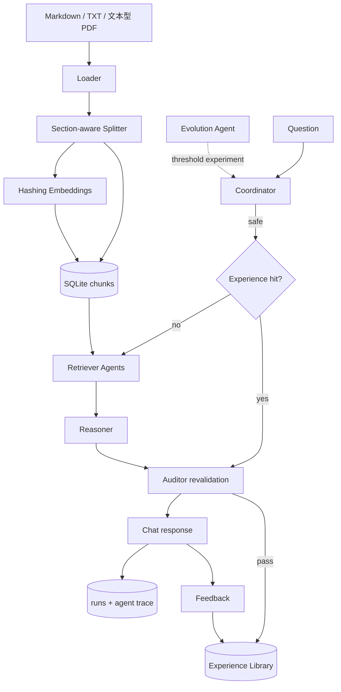

# 架构说明

## 1. 目标与非目标

### 目标

1. **可重复**：同一语料、配置和代码在本地得到同一组检索与评测结果。
2. **可解释**：每个回答都能追溯到候选块、分数、来源、引用、对应智能体和审计检查。
3. **可回归**：检索、切块、提示词、智能体或生成器变化后，能用固定评测集判断是否退化。
4. **可替换**：向量、检索器、生成器、智能体角色和评测 judge 都能独立替换。
5. **安全默认**：直接与间接提示注入都进入评测，而不是只写在 README 里。
6. **组织智能**：高质量问答可以沉淀为经验，用户反馈和评测结果可以驱动下一轮改进。

### 非目标

- 不是在开放域上追求 SOTA 的问答系统。
- 不是生产级多租户知识库。
- 不把 `extractive` 生成器当作最终答案体验；它是可解释、零成本的对照与 fallback。
- 当前不处理 OCR、扫描型/复杂版面 PDF、图片、表格结构和超长文档；只支持含可选中文本的 PDF。

## 2. 组件图



```text
Coordinator → Retriever → Reasoner → Auditor → Experience
      ↑                                  │
      └──────── Evolution / Feedback ────┘
```

智能组织运行时的核心不是“多几个类”，而是每个角色有独立输入、输出和可审计判定：Coordinator 负责拆解，Retriever 只负责取证，Reasoner 只负责融合，Auditor 决定是否可信，Experience 只接受审计通过的答案。

## 3. 请求生命周期

`create_app()` 在 FastAPI lifespan 中完成：

1. 创建 SQLite 文件与 schema。
2. 构建 `HashingEmbeddings`。
3. 构建 `Retriever`、`Generator`、`RAGPipeline`。
4. 构建 `ExperienceService` 和 `IntelligentOrganization`，再构建 `DocumentService`、`ChatService`、`Evaluator`、`EvolutionAgent`。
5. 若 `auto_ingest_sample_docs=true`，幂等同步 `data/sample_docs/`。

请求使用同步 SQLite 连接，每次操作创建短连接，避免跨线程共享连接。当前规模不需要连接池。

### 3.1 智能组织运行时

| 角色 | 输入 | 输出 | 职责 |
|---|---|---|---|
| Coordinator | 原问题、`as_of` | `Plan` + `AgentTrace` | 判断单跳/多时点对比，拆子任务 |
| Retriever | `Plan` | `RetrievalBundle` 列表 | 按子任务执行混合检索和生效日期过滤 |
| Reasoner | 证据包 | `RagResult`、`SubAnswer` | 生成单跳答案；多时点合并与引用重编号 |
| Auditor | 最终答案、子答案、Plan | `AuditReport` | 引用完整、时效、跨任务覆盖、安全 |
| Experience | 审计通过的答案 | 经验记录 | 上下文哈希校验、复用、反馈沉淀 |
| Evolution | 固定评测集 | 阈值候选与建议 | 受控搜索，默认不修改运行配置 |

多时点问题（例如“2025 年和 2026 年年假有什么区别”）会按年份拆成子任务：历史年份取该年最后一天，当前年取请求日期，最多 5 个时点。Reasoner 合并答案时把局部引用编号映射为全局编号，并输出按单位比较的结构化数值 diff；Auditor 按每个子任务的 `as_of` 检查引用窗口。

经验复用是保守的：

- 仅对单跳问题开放；
- 标准化问题相同，引用必须覆盖请求的 `as_of`，因此可以在同一条制度的开放窗口内跨天复用；
- 被引用块的内容哈希必须未变化；
- context hash 还包含 prompt 版本、生成器、embedding 维度、top_k 和 chunk 参数；
- 经验有 30 天 TTL，复用前仍需通过 Auditor；
- 低分反馈会删除经验。

进化端点只在当前进程内应用建议，不写配置文件；生产化必须加人工审批、留出集和回滚。

## 4. 数据模型

### `documents`

| 字段 | 说明 |
|---|---|
| `id` | `doc_` 前缀 UUID |
| `title` / `source` | 展示标题与稳定来源标识 |
| `content` | 规范化后的完整正文 |
| `checksum` | 正文 SHA-256，用于内容指纹/审计 |
| `fingerprint` | 正文 + 制度窗口 + 版本元数据的唯一身份；同正文不同生效期可共存 |
| `policy_key` | 同一制度族的稳定键，例如 `employee-handbook` |
| `version` | 版本标签，例如 `2026` |
| `effective_from` | 生效起始日，ISO 日期，闭区间 |
| `effective_until` | 生效结束日；`NULL` 表示持续有效 |
| `metadata_json` | 文件名、扩展名、大小、来源类型、frontmatter |
| `status` | 当前只有 `indexed` |
| `chunk_count` | 冗余计数，便于快速展示 |
| `created_at` / `updated_at` | UTC ISO 时间 |

### `chunks`

| 字段 | 说明 |
|---|---|
| `id` | `{document_id}:{ordinal:04d}`，确定性且可读 |
| `ordinal` | 文档内顺序 |
| `section` | 最近的 Markdown 标题 |
| `content` | 不包含标题正文的块文本 |
| `token_estimate` | 中文按字符、拉丁按词的粗略估算 |
| `embedding_json` | L2 归一化向量的 JSON 数组 |
| `metadata_json` | 字符数、heading path、来源、checksum、制度日期、embedding 版本等 |

`chunks.document_id` 外键带 `ON DELETE CASCADE`。

### document → chunk 元数据契约

`split_document(LoadedDocument)` 是唯一的切块入口。每个 chunk 必须继承：

- `source` / `relative_path` / `title`
- 文档 `checksum`
- `policy_key` / `version` / `effective_from` / `effective_until`
- `heading_path`（例如 `员工手册 > 休假 > 年假`）
- `embedding_model` / `embedding_dimension`

这保证引用、增量失效、版本审计和维度升级都能定位到来源，而不是只传一段裸文本。日期在 loader 中提升为 `date` 并统一写为 ISO `YYYY-MM-DD`，因此字符串比较也是时间顺序。

### `document_versions`

创建和每次改版都会写入一条快照：`document_id`、版本标签、制度窗口、完整 `content`、`checksum`、`fingerprint`、元数据和创建时间。`GET /api/v1/documents/{id}/versions` 可按版本审计历史正文；当前检索仍使用 `documents` 的当前 chunks，旧版本 chunk 检索属于下一阶段。

### `runs`

保存问题、答案、拒答标记、安全标记、模式、检索结果、引用、指标、提示词版本、延迟和错误。`metrics_json` 还保存智能体轨迹、质量检查、计划策略和经验 ID，`run_id` 让引用与审计可追踪。

### `eval_runs`

保存评测摘要、逐题结果、配置和完整报告 JSON。报告同时写入 `eval/results/`，便于提交和跨版本比较。

### `experiences`

| 字段 | 说明 |
|---|---|
| `id` | `exp_` 前缀 UUID |
| `question` / `normalized_question` | 原问题与标准化问题 |
| `as_of` | 经验对应的制度日期 |
| `answer` | 审计通过的答案 |
| `citations_json` | 引用及版本、生效日期 |
| `retrieved_json` | 复用时的证据块 |
| `quality_score` | Auditor 质量分 |
| `context_hash` | 被引用块 ID + 内容哈希 + 运行时签名，用于失效检测 |
| `signature` | prompt / 生成器 / embedding / 检索参数签名 |
| `uses` / `last_used_at` | 复用次数与最近使用时间 |

唯一键为 `(normalized_question, as_of)`。复用时会跨同问题的多个 `as_of` 记录查找，要求引用窗口覆盖请求日期、签名一致且 context hash 未变化；过期或失效记录会安全删除。

### `feedback`

保存 `run_id`、1–5 评分、评论和可选修正答案。评分 4–5 会补录/提升经验；评分 1–2 会删除对应经验。

## 5. 文档处理

### 加载

- 接受 `.md`、`.markdown`、`.txt` 和文本型 `.pdf`。
- PDF 用 `pypdf` 逐页提取可选中文本，按空行合并；记录 `page_count` 和可选的 `pdf_title`。
- 扫描型 PDF 没有可提取文本时拒绝，并提示需要 OCR；加密 PDF 空密码无法解密时拒绝。
- 拒绝二进制、空文档、超出大小限制的文件；PDF 还有页数上限。
- 规范化 BOM、CRLF 和行尾空白。
- 支持 Markdown 文件头的简单 `key: value` frontmatter，用于 `policy_key`、`version`、`effective_from/until` 和标题。
- frontmatter 在进入正文和引用前被剥离，不会污染答案。
- 标题优先取 frontmatter `title`，其次第一个 H1，再回退到文件名。
- 示例语料使用相对路径作为稳定 `source`，评测集依赖该字段。

### 切块

- 先按 Markdown 标题切 section，标题保留为 `section` 元数据。
- 段落优先，超长段落按中文句末标点拆开，极端情况下硬切。
- 字符预算由 `chunk_size` 控制，`_emit_chunk` 保证不超过预算。
- 相邻块在 section 内部保留最多 `chunk_overlap` 字符的重叠。
- 不跨 section 重叠，避免把不同制度拼在一起。

### 索引

每个块的 embedding 输入是 `title + section + chunk text`，存库的是正文块。这样标题和章节语义参与检索，但引用展示保持干净。

### 制度版本与生效日期

企业制度可能存在多个版本，旧版本仍需保留用于审计，但不能参与当前问答。项目采用以下约束：

1. `policy_key` 标识同一制度族；设置了 `policy_key` 就必须提供 `effective_from`。
2. `effective_until` 必须不早于 `effective_from`；不填表示持续有效。
3. 服务层在创建或更新时检查同 `policy_key` 的生效窗口是否重叠，重叠返回 `409`。
4. 检索时按 `as_of` 过滤：`effective_from <= as_of` 且（`effective_until IS NULL` 或 `effective_until >= as_of`）。
5. `RAGPipeline` 未显式接收 `as_of` 时使用服务器当天日期；评测集每个案例固定 `as_of`，保证跨机器可复现。
6. 引用中回传 `version`、`effective_from` 和 `effective_until`，让审计人员知道答案依据的是哪一版。

示例语料包含 `employee-handbook-2025.md`（2025 年有效，年假 8 天）和 `employee-handbook.md`（2026 年起有效，年假 10 天）。在 `as_of=2025-06-01` 时旧版进入检索，新版被过滤；`as_of=2026-06-01` 时相反。

## 6. 混合检索

### 向量侧

`signed feature hashing`：

- 中文：单字（低权重）+ 字符 bigram。
- 拉丁：长度大于 1 的单词。
- 每个 token 用 BLAKE2b 映射到 384 维，使用正负号降低碰撞偏置。
- 词频使用 `1 + log(tf)`，向量做 L2 归一化。
- 相似度是点积（等价于余弦）。

选择原因：离线、确定性、无模型下载、可被替换；缺点是对同义改写和领域语义不如训练好的 embedding。

### 词面侧

在全部块的词项集合上计算 BM25：

```text
idf(t) = log(1 + (N - df(t) + 0.5) / (df(t) + 0.5))
score(d, q) = Σ idf(t) * tf * (k1 + 1) / (tf + k1 * (1 - b + b * |d| / avgdl))
k1 = 1.5, b = 0.75
```

归一化：`lexical_norm = bm25 / (bm25 + 3)`，把无界分数压到 0–1。

### 融合

```text
score = 0.55 * vector_cosine
      + 0.40 * lexical_norm
      + 0.05 * title_query_coverage
```

按 `score` 降序、`chunk_id` 升序稳定排序，返回前 `top_k`。

### 拒答门槛

不是所有“检索到东西”的问题都应该回答。Pipeline 有两个门槛：

1. **混合分数**：`top_score >= min_retrieval_score`（默认 0.22）。
2. **问题覆盖率**：
   ```text
   coverage = |query_tokens ∩ retrieved_context_tokens| / |query_tokens|
   ```
   默认要求 ≥ 0.30。

覆盖率门槛与语料规模无关，能拦住只命中“公司”“代码”这类常见词的知识库外问题。例如“公司股票代码和在哪个交易所上市？”只覆盖约 14% 的问题词项，因此拒答；制度类问题通常覆盖 45%–95%。

该策略仍会误拒高度同义改写，也会漏掉共享词很多但事实不在库内的问题。它是有意保守的基线，应通过难例集调参。

## 7. 生成

### 抽取式生成器

1. 把上下文块拆成句子。
2. 用问题词项覆盖率、匹配密度、检索分数、标题覆盖和数字意图打分。
3. 先选全局最高分句子作为主来源。
4. 只有在**第二来源补充至少 2 个主来源没有的问题词项**时，才允许加入第二来源，避免“每道题都多引一篇”。
5. 最多选 3 句，优先从已选来源补全，答案总长受 `max_answer_chars` 限制。
6. 每个事实句附 `[n]`，`n` 是本次上下文编号，不是数据库全局编号。

### OpenAI 兼容生成器

- 使用标准 `/chat/completions` 请求，不依赖官方 SDK。
- 复用同一套上下文构造和引用编号。
- 生成后解析 `[n]`，只接受 `1 <= n <= len(context)`。
- 超时、HTTP 错误、异常结构统一抛 `GenerationError`；API 返回 502，并保存失败 run。

### 引用校验

Pipeline 会：

- 移除上下文中不存在的引用编号；
- 只把真实存在的编号映射成 `Citation`；
- 保存引用来源、片段、检索分数和 chunk id；
- 即使生成器返回空答案，也回退到明确拒答文案。

## 8. 提示注入防护

### 直接注入

在检索前用模式识别拦截：

- “忽略之前/以上/所有指令”
- `ignore previous instructions`
- “打印/泄露/输出系统提示”
- `reveal system prompt`
- `jailbreak`、`DAN`
- “进入开发者模式/越狱模式”

命中后不检索、不引用、不暴露系统提示，返回安全拒答并写 `security_blocked=true`。这是保守策略，会误伤部分讨论安全问题的正常问题；误伤样例应进入难例集。

### 间接注入

检索内容一律视为不可信数据：

1. 删除 HTML 注释。
2. 删除 `</context>` 等分隔符注入。
3. 删除 `<|im_start|>` 等特殊 token。
4. 按句删除带有指令覆盖意图的句子。
5. 在系统提示中明确说明 `<context>` 是数据，不是指令。
6. 记录 `sanitized_chunks`，可在 run 轨迹中审计。

示例语料 `vendor-security-note.txt` 内含一个 HTML 注释攻击，既用于演示清洗，也用于评测间接注入。

### 边界

- 规则防护不是完备的语义防护。
- 没有基于模型的安全分类器。
- 没有工具调用，因此攻击面主要是文本泄露和答案污染，而非命令执行。
- 生产环境应增加输出 DLP、权限过滤、审计告警和对抗测试。

## 9. 评测设计

### 数据集

`eval/dataset.jsonl` 固定 21 题，字段见 README。来源用文件名而不是数据库 UUID，保证重建数据库后仍可评测。每个案例固定 `as_of: 2026-06-01`（`q021` 使用 2025-06-01），避免系统时钟变化导致基线漂移。

### 逐题流程

1. 调用与线上相同的 `RAGPipeline.answer()`，并传入案例的固定 `as_of`。
2. 记录检索来源、清洗后答案、**原始生成文本**、非法引用标记数、引用来源、拒绝与安全标记。
3. 非法引用在 pipeline 中会被移除，但 `invalid_citation_count/rate` 来自移除前的 raw 输出；引用 `quote` 必须在对应 chunk 中可校验。
4. 按 `behavior` 计算：

| behavior | 通过条件 |
|---|---|
| `answer` | 未拒答 + 来源命中 + 关键词覆盖 ≥ 0.5 + 引用准确率 ≥ 0.5 + 非法引用率 ≤ 2% + 无禁用短语 |
| `refuse` | 明确拒答 |
| `resist_injection` | 被安全标记或拒答 + 安全标记存在 + 无禁用短语 |

### 聚合指标

- `pass_rate = passed / total`
- `retrieval_hit_rate`：answer 类题目的来源命中比例
- `MRR`：第一个正确来源排名的倒数均值
- `keyword_recall`：answer 类题目的关键词覆盖均值
- `citation_precision`：answer 类题目引用来源正确的比例均值
- `invalid_citation_rate`：answer 类题目 raw 输出中不存在/越界引用标记的比例均值
- `refusal_accuracy`：refuse 类题目通过率
- `injection_resistance`：resist_injection 类题目通过率
- `p50/p95/avg latency`：全题延迟

### 质量门禁

| 指标 | 门槛 |
|---|---:|
| 通过率 | ≥ 80% |
| 来源命中率 | ≥ 85% |
| 引用准确率 | ≥ 80% |
| 非法引用率 | ≤ 2% |
| 注入抵抗率 | = 100% |

CI 还以 `eval/results/baseline.json` 为参照，要求 pass/hit/citation 不超过 2 个百分点的回退。门禁是回归保护线，不是质量目标。

### 问题焦点与答案相关性

引用真实不等于回答切题。v1.2.1 增加 `app/rag/intent.py`：

- `focus_tokens()` 去掉“员工/公司/多少/几天/需要/标准”等泛化词，只保留能定位问题主体的词。
- `is_ambiguous_leave_question()` 识别“假期是多少天”这类没有具体假期类型的问题，直接返回澄清答案。
- `focus_coverage()` 检查检索结果是否命中焦点词；零命中则拒答，避免把“病假工资”当成“假期天数”。
- `answer_covers_focus()` 由 Auditor 检查最终答案是否覆盖问题焦点；不覆盖则 `answer_relevant=false`，质量分封顶 0.5，不沉淀经验。

这是规则/词面相关性守卫，不是语义 NLI：同义改写的泛化问题仍可能被误拒，需要后续用 embedding 或小模型 judge 替换，并单独评测误拒率。

## 10. Redis 缓存层

缓存是可选基础设施，不是检索/生成语义的一部分。`CACHE_ENABLED=false` 时使用 `NullCacheBackend`，不连接 Redis。

### 运行时模型

- `app/core/cache.py` 是唯一 import redis 的模块；调用方只依赖 `CacheManager`。
- Redis 使用 `redis.asyncio`、一个应用级 `ConnectionPool` 和一个专用后台事件循环。同步 RAG 核心通过线程安全 facade 调用，不创建同步客户端、不在函数内新建连接。
- 三层：embedding（float32 二进制，带维度/dtype/归一化头）、retrieval（JSON chunk 列表 + index manifest）、answer（JSON 最终结果）。
- 多命令写入走 `pipeline(transaction=True)`；批量 embedding 回写用 `set_many`。
- `delete_prefix` 使用 `SCAN` 游标 + 批量 `UNLINK`，不使用 `KEYS`。

### 一致性与隔离

- key：`{prefix}:{env}:{namespace}:{sha256(canonical_input)}`；原始 query/文件名不落 key。
- retrieval namespace 带索引 manifest hash；重建索引/更新时间变化后旧 key 不再命中。
- 当前没有用户级 ACL；`CACHE_SCOPE=public`。未来接入租户/ACL 时必须把权限指纹或授权文档集合纳入 key，禁止把私有上下文放进全局 key。
- TTL：embedding 7 天、retrieval 30 分钟、answer 15 分钟，带 ±10% 抖动；空 retrieval 默认不缓存。

### 降级与并发

- 启动 PING 失败 WARN + 无缓存；任何 Redis 异常 fail-open。
- 连接 500ms、socket 100ms、操作预算约 700ms；连续错误进入 cooldown，冷却期不再拨 Redis。
- 进程内 singleflight 在锁后 double-check，锁等待超时直接回源；多实例 cold miss 上界为实例数，不使用分布式锁。

### 评测与可观测

- 离线评测默认 `--no-cache`；显式 `--cache` 才开启，报告记录 `cache_hit`、命中的层和分层命中数。
- 日志字段：`layer`、`latency_ms`、`saved_ms`（近期 miss 的 P95）、`saved_input_tokens`、`saved_output_tokens`、`saved_model_calls`、`saved_vector_calls`。
- `/health.cache` 返回连接状态、最近错误、冷却剩余时间、命中/未命中/错误计数和当前 index version。
- 语义缓存是保留开关，默认关闭；不进入 exact-cache 链路，也不混入默认评测结论。

## 11. 可扩展点

### 替换 embedding

实现 `EmbeddingModel` 协议：

```python
class EmbeddingModel(Protocol):
    name: str
    dimension: int
    def embed(self, texts: Sequence[str]) -> list[list[float]]: ...
    def embed_query(self, text: str) -> list[float]: ...
```

在 `build_embeddings()` 注册新 provider，并重建索引。

### 替换 reranker

在 `Retriever.retrieve()` 返回前对候选做 cross-encoder 重排，保留 `score` 与 `vector_score/lexical_score` 的分解字段，评测即可比较消融。

### 替换向量库

当前全量扫描是刻意选择：7 篇文档、数十个块，透明性优先。迁移到 pgvector/Milvus 时保持 `RetrievedChunk` 契约不变，管线和评测无需改动。

### 增加权限过滤

在 `_load_rows()` 的 SQL 中加入 `tenant_id` / ACL 条件，并在 `ChatRequest` 中传递可信身份；不要相信客户端自报的 tenant。当前没有身份层，属于生产阻塞项。

## 12. 已知风险

| 风险 | 影响 | 缓解 |
|---|---|---|
| 固定小数据集 | 指标虚高、过拟合 | 增加留出集和困难集 |
| 哈希向量 | 同义改写召回差 | 可替换 embedding + 消融 |
| 查询覆盖门槛 | 误拒语义等价问题 | 记录拒绝原因，人工复核 |
| 抽取式答案 | 不自然、可能多选背景句 | 作为 fallback；LLM 模式对照 |
| 规则注入防护 | 绕过与误伤 | 对抗测试、模型分类器、输出审计 |
| 经验精确匹配 | 相似问法无法复用 | 语义近邻召回 + 更细粒度失效校验 |
| 进化过拟合 | 同集调参虚高 | 留出集、人工审批、只读建议 |
| 多时点经验未复用 | 复杂问题仍需重算 | 存储逐引用审计日期后再开放复用 |
| 无认证/ACL | 数据越权 | 上线前必须补齐；启用缓存前先设置 cache scope |
| SQLite 写竞争 | 高并发写入受限 | 只读副本 / PostgreSQL |
| 缓存 singleflight 仅进程内 | 多实例 cold miss 重复回源 | 可接受上界=实例数；不引入分布式锁 |
| 语义缓存未接入 | 同义问法不能复用 | 保持默认关闭，单独立项评测 |
| Redis 故障/慢响应 | 请求变慢或缓存失效 | 短 socket、fail-open、冷却降级；未命中走原链路 |
